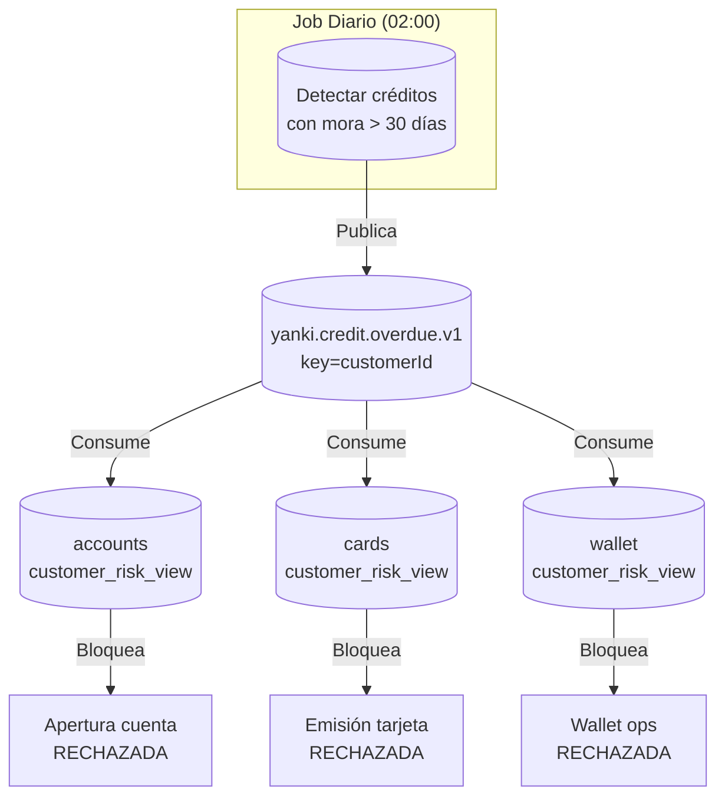

# credits-service

Microservicio de **créditos activos** de la plataforma bancaria **Yanki**.

Gestiona productos de crédito, como personal, empresarial e hipotecario. Ofrece funcionalidades para control de apertura de créditos, pagos, amortización, detección de mora y restricciones de productos a causa de mora.

- **Puerto:** `8084`
- **Base de datos propia:** MongoDB `yanki_credits` (colecciones: `credits`, `payments`, `customer_profile_view`, `customer_card_view`)
- **Cache:** Redis (cálculos de cuotas, saldos, plan amortización TTL configurable)
- **Stack:** Java 17, Spring Boot 3.3.5, Spring WebFlux, Spring Data Reactive (MongoDB + Redis), RxJava 3, Spring Kafka, springdoc-openapi

---

## 1. Propósito

| Responsabilidad | Detalle |
|---|---|
| Apertura de Créditos | Limitado a un crédito personal por cliente, múltiples créditos empresariales permitidos, y créditos hipotecarios requieren validación adicional |
| Pagos y amortización | Registra pagos, recalcula saldo, genera plan de amortización |
| Mora (overdue) | Job diario detecta mora > 30 días → publica `credit.overdue.v1` |
| Bloqueo transversal | Evento `credit.overdue.v1` bloquea nuevos productos en accounts, cards, wallet |
| Vistas locales | Perfil cliente (límites), riesgo y tarjetas (scoring) vía eventos Kafka |
| Operación autónoma | Contiene especificación funcional, técnica, de integración, pruebas y criterios suficientes para que un agente implemente el microservicio sin depender de interpretación implícita |

### 1.1 Fuentes de verdad usadas para esta especificación

Este documento consolida la información necesaria desde:
- `README.md` de la raíz del monorepo.
- `CASOS_USO/CU-03-Gestion-Creditos.md`.
- `CASOS_USO/CU-06-Pagos-Creditos.md`.
- `CASOS_PRUEBA/CASOS_PRUEBA_QA.md`.
- `docs/EVENTOS.md`.
- Convenciones técnicas del repositorio (`CONVENTIONS.md`).

El objetivo es que este `README.md` sirva como documento autosuficiente para que un agente autónomo pueda diseñar, construir, probar y documentar `credits-service`.

---

## 2. Endpoints REST

Base: `/api/credits`

| Método | Ruta | Descripción | Respuesta exitosa |
|---|---|---|---|
| `POST` | `/api/credits` | Solicitar crédito (PERSONAL/BUSINESS/MORTGAGE) | `201 Created` + `CreditResponse` |
| `GET` | `/api/credits` | Listar (filtros: customerId, type, status) | `200 OK` + `PageResponse<CreditResponse>` |
| `GET` | `/api/credits/{id}` | Detalle crédito + plan pagos | `200 OK` + `CreditResponse` |
| `PUT` | `/api/credits/{id}` | Actualizar crédito (cambio de tasa de interés) | `200 OK` + `CreditResponse` |
| `DELETE` | `/api/credits/{id}` | Cancelar crédito | `200 OK` + `CreditResponse` |
| `POST` | `/api/credits/{id}/payments` | Registrar pago de crédito | `201 Created` + `PaymentResponse` |
| `GET` | `/api/credits/{id}/payments` | Listar pagos de un crédito | `200 OK` + `List<PaymentResponse>` |
| `GET` | `/api/credits/{id}/payments/{paymentId}` | Consultar pago por ID | `200 OK` + `PaymentResponse` |
| `PUT` | `/api/credits/{id}/payments/{paymentId}` | Corregir pago (corrección de monto) | `200 OK` + `PaymentResponse` |
| `DELETE` | `/api/credits/{id}/payments/{paymentId}` | Revertir pago (reversa) | `200 OK` + `PaymentResponse` |
| `GET` | `/api/credits/{id}/schedule` | Plan de amortización | `200 OK` + `ScheduleResponse` |
| `POST` | `/api/credits/jobs/overdue-detection` | Ejecutar job de mora manualmente | `200 OK` + mensaje |

### 2.1 Cobertura de respuestas HTTP por endpoint

#### `POST /api/credits`
**Casos de éxito**
- `201 Created`: crédito solicitado/aprobado correctamente.
- `202 Accepted`: solicitud recibida cuando la evaluación es asíncrona o queda en estado `PENDING`.

**Casos de error**
- `400 Bad Request`: payload inválido, tipo de crédito inválido, monto inválido, plazo inválido o `PERSONAL_CREDIT_LIMIT_EXCEEDED`.
- `401 Unauthorized`: ausencia de JWT o token inválido.
- `403 Forbidden`: `CUSTOMER_BLOCKED`, `CREDIT_OVERDUE` o cliente no habilitado para el producto solicitado.
- `404 Not Found`: cliente no existe en la vista local requerida para evaluación.
- `409 Conflict`: solicitud duplicada o crédito incompatible con el estado actual del cliente.
- `422 Unprocessable Entity`: reglas de negocio incumplidas para evaluación hipotecaria o falta de garantía requerida.
- `500 Internal Server Error`: error interno no controlado.
- `503 Service Unavailable`: dependencias críticas no disponibles (MongoDB, Redis, Kafka, Config Server, Eureka).

#### `GET /api/credits`
**Casos de éxito**
- `200 OK`: consulta exitosa con o sin resultados.

**Casos de error**
- `400 Bad Request`: filtros inválidos o combinación de parámetros no soportada.
- `401 Unauthorized`: ausencia de JWT o token inválido.
- `403 Forbidden`: acceso no autorizado al portafolio consultado.
- `500 Internal Server Error`: error interno no controlado.
- `503 Service Unavailable`: dependencias críticas no disponibles.

#### `GET /api/credits/{id}`
**Casos de éxito**
- `200 OK`: detalle del crédito encontrado.

**Casos de error**
- `400 Bad Request`: formato de identificador inválido.
- `401 Unauthorized`: ausencia de JWT o token inválido.
- `403 Forbidden`: cliente sin permisos sobre el crédito consultado.
- `404 Not Found`: `CREDIT_NOT_FOUND`.
- `500 Internal Server Error`: error interno no controlado.
- `503 Service Unavailable`: dependencias críticas no disponibles.

#### `POST /api/credits/{id}/payments`
**Casos de éxito**
- `201 Created`: pago registrado correctamente.
- `200 OK`: pago idempotente ya procesado y retornado sin reprocesamiento.

**Casos de error**
- `400 Bad Request`: `INVALID_PAYMENT_AMOUNT`, payload inválido, cuenta origen inválida o monto cero/negativo.
- `401 Unauthorized`: ausencia de JWT o token inválido.
- `403 Forbidden`: operación no permitida por estado del crédito o restricciones del cliente.
- `404 Not Found`: `CREDIT_NOT_FOUND`.
- `409 Conflict`: `CREDIT_ALREADY_PAID`, pago duplicado o conflicto por estado concurrente.
- `422 Unprocessable Entity`: pago excede reglas permitidas de amortización/reestructuración.
- `500 Internal Server Error`: error interno no controlado.
- `503 Service Unavailable`: dependencias críticas no disponibles o fallo al publicar evento de pago.

#### `GET /api/credits/{id}/schedule`
**Casos de éxito**
- `200 OK`: plan de amortización generado o recuperado desde caché.

**Casos de error**
- `400 Bad Request`: formato de identificador inválido.
- `401 Unauthorized`: ausencia de JWT o token inválido.
- `403 Forbidden`: cliente sin permisos sobre el crédito consultado.
- `404 Not Found`: `CREDIT_NOT_FOUND`.
- `500 Internal Server Error`: error interno no controlado.
- `503 Service Unavailable`: dependencias críticas no disponibles (MongoDB/Redis).

#### `PUT /api/credits/{id}`
**Casos de éxito**
- `200 OK`: crédito actualizado exitosamente con nueva tasa de interés y cronograma regenerado.

**Casos de error**
- `400 Bad Request`: tasa de interés inválida (fuera de rango 0.01 a 50).
- `401 Unauthorized`: ausencia de JWT o token inválido.
- `403 Forbidden`: crédito no elegible para actualización (pagado, cancelado o en mora).
- `404 Not Found`: `CREDIT_NOT_FOUND`.
- `500 Internal Server Error`: error interno no controlado.
- `503 Service Unavailable`: dependencias críticas no disponibles.

#### `DELETE /api/credits/{id}`
**Casos de éxito**
- `200 OK`: crédito cancelado exitosamente.

**Casos de error**
- `401 Unauthorized`: ausencia de JWT o token inválido.
- `403 Forbidden`: crédito no cancelable (pagado, ya cancelado o en mora).
- `404 Not Found`: `CREDIT_NOT_FOUND`.
- `500 Internal Server Error`: error interno no controlado.
- `503 Service Unavailable`: dependencias críticas no disponibles.

#### `GET /api/credits/{id}/payments`
**Casos de éxito**
- `200 OK`: lista de pagos obtenida exitosamente.

**Casos de error**
- `404 Not Found`: `CREDIT_NOT_FOUND`.
- `500 Internal Server Error`: error interno no controlado.

#### `GET /api/credits/{id}/payments/{paymentId}`
**Casos de éxito**
- `200 OK`: pago encontrado con todos sus detalles.

**Casos de error**
- `404 Not Found`: `CREDIT_NOT_FOUND` o `PAYMENT_NOT_FOUND`.
- `500 Internal Server Error`: error interno no controlado.

#### `PUT /api/credits/{id}/payments/{paymentId}`
**Casos de éxito**
- `200 OK`: pago corregido exitosamente con nuevo monto y saldo del crédito ajustado.

**Casos de error**
- `400 Bad Request`: `INVALID_PAYMENT_AMOUNT`, monto corregido inválido (cero o negativo).
- `401 Unauthorized`: ausencia de JWT o token inválido.
- `403 Forbidden`: crédito cancelado o pagado totalmente.
- `404 Not Found`: `CREDIT_NOT_FOUND` o `PAYMENT_NOT_FOUND`.
- `409 Conflict`: pago ya revertido o no pertenece al crédito indicado.
- `500 Internal Server Error`: error interno no controlado.
- `503 Service Unavailable`: dependencias críticas no disponibles.

#### `DELETE /api/credits/{id}/payments/{paymentId}`
**Casos de éxito**
- `200 OK`: pago revertido exitosamente; monto devuelto al saldo del crédito.

**Casos de error**
- `401 Unauthorized`: ausencia de JWT o token inválido.
- `403 Forbidden`: crédito cancelado.
- `404 Not Found`: `CREDIT_NOT_FOUND` o `PAYMENT_NOT_FOUND`.
- `409 Conflict`: pago ya revertido previamente o no pertenece al crédito indicado.
- `500 Internal Server Error`: error interno no controlado.
- `503 Service Unavailable`: dependencias críticas no disponibles.

#### `POST /api/credits/jobs/overdue-detection`
**Casos de éxito**
- `200 OK`: job de detección de mora ejecutado exitosamente.

**Casos de error**
- `500 Internal Server Error`: error interno al ejecutar el job.
- `503 Service Unavailable`: dependencias críticas no disponibles.

#### `POST /api/credits/{id}/restructure`
**Casos de éxito**
- `200 OK`: reestructuración aplicada exitosamente.
- `202 Accepted`: reestructuración enviada a evaluación asíncrona.

**Casos de error**
- `400 Bad Request`: solicitud inválida, términos no permitidos o payload inconsistente.
- `401 Unauthorized`: ausencia de JWT o token inválido.
- `403 Forbidden`: crédito no elegible para reestructuración o cliente bloqueado.
- `404 Not Found`: `CREDIT_NOT_FOUND`.
- `409 Conflict`: crédito ya reestructurado recientemente o estado incompatible.
- `422 Unprocessable Entity`: incumplimiento de reglas de negocio para reestructuración.
- `500 Internal Server Error`: error interno no controlado.
- `503 Service Unavailable`: dependencias críticas no disponibles.

### 2.1 Ejemplos

```bash
# Crédito personal
curl -X POST http://localhost:8084/api/credits \
  -H "Content-Type: application/json" \
  -H "Authorization: Bearer <token>" \
  -d '{
        "customerId": "CUST-123",
        "type": "PERSONAL",
        "amount": 5000,
        "termMonths": 24,
        "interestRate": 12.5
      }'

# Crédito empresarial
curl -X POST http://localhost:8084/api/credits \
  -H "Content-Type: application/json" \
  -H "Authorization: Bearer <token>" \
  -d '{
        "customerId": "CUST-456",
        "type": "BUSINESS",
        "amount": 50000,
        "termMonths": 36,
        "interestRate": 10.5,
        "purpose": "Capital de trabajo"
      }'

# Pago de cuota
curl -X POST http://localhost:8084/api/credits/CRED-123/payments \
  -H "Content-Type: application/json" \
  -d '{"amount": 250, "sourceAccountId": "ACC-123"}'

# Plan de pagos
curl http://localhost:8084/api/credits/CRED-123/schedule
```

### 2.2 Catálogo de errores funcionales

| Código | HTTP | Causa |
|---|---|---|
| `CREDIT_NOT_FOUND` | 404 | Crédito no existe |
| `PERSONAL_CREDIT_LIMIT_EXCEEDED` | 400 | Cliente ya tiene crédito personal |
| `CREDIT_OVERDUE` | 403 | Crédito en mora (bloquea nuevos productos o ciertas operaciones) |
| `CUSTOMER_BLOCKED` | 403 | Deuda vencida en risk view o bloqueo vigente |
| `INVALID_PAYMENT_AMOUNT` | 400 | Monto pago inválido |
| `CREDIT_ALREADY_PAID` | 409 | Crédito ya pagado totalmente |
| `INVALID_CREDIT_TYPE` | 400 | Tipo de crédito no soportado |
| `INVALID_TERM` | 400 | Plazo inválido |
| `INVALID_INTEREST_RATE` | 400 | Tasa inválida |
| `CUSTOMER_NOT_FOUND` | 404 | Cliente no encontrado en vista local |
| `PAYMENT_DUPLICATED` | 409 | Pago ya procesado previamente |
| `RESTRUCTURE_NOT_ALLOWED` | 422 | Crédito no elegible para reestructuración |
| `EXTERNAL_DEPENDENCY_UNAVAILABLE` | 503 | Dependencia crítica no disponible |
| `UNAUTHORIZED` | 401 | Token ausente, vencido o inválido |
| `FORBIDDEN_OPERATION` | 403 | Operación no permitida por política o ownership |

---

## 3. Lógica de Negocio

### 3.0 Resumen funcional completo

El microservicio `credits-service` es responsable de administrar el ciclo de vida de los productos de crédito de Yanki. Su lógica de negocio incluye:
- originación de créditos personales, empresariales e hipotecarios;
- validación del perfil del cliente usando vistas locales alimentadas por eventos;
- control de restricciones de apertura según tipo de cliente y riesgo;
- cálculo de cuotas, intereses, cronogramas y saldo pendiente;
- registro de pagos normales, anticipados y pagos realizados por terceros;
- detección de mora y propagación del bloqueo transversal a otros microservicios;
- soporte de reestructuración bajo reglas de elegibilidad;
- publicación de eventos de dominio para mantener consistencia eventual en la plataforma.

Toda decisión funcional del servicio debe considerar el estado del crédito, el estado del cliente, la consistencia de las vistas locales y la disponibilidad de las dependencias críticas.

### 3.1 Límites por Tipo de Cliente

| Tipo Crédito | Límite | Cliente |
|---|---|---|
| **Personal** | Máx 1 | PERSONAL |
| **Empresarial** | Múltiples | ENTERPRISE |
| **Hipotecario** | Múltiples | PERSONAL/ENTERPRISE (con garantía) |

### 3.1.1 Reglas explícitas derivadas de casos de uso

- Un cliente `PERSONAL` no puede tener más de un crédito personal vigente.
- Un cliente `ENTERPRISE` puede mantener múltiples créditos empresariales vigentes.
- Un crédito hipotecario requiere validación de garantía y cumplimiento de scoring/reglas de aprobación.
- La existencia de deuda vencida por más de 30 días bloquea la adquisición de nuevos productos.
- El servicio debe permitir pagos propios y pagos de terceros.
- El servicio debe soportar pagos parciales, pagos totales y pagos anticipados.
- La consulta de cronograma debe poder resolverse desde Redis o reconstruirse desde MongoDB.
- La lógica debe ser compatible con consistencia eventual basada en eventos Kafka.

### 3.2 Mora y Bloqueo Transversal (Parte III)

- **Job diario** (02:00 UTC-5): Detecta créditos con cuotas vencidas > 30 días
- Publica `yanki.credit.overdue.v1` → `customer_risk_view.hasOverdueDebt = true`
- **Efecto transversal**: Bloquea apertura cuentas, emisión tarjetas, operaciones wallet



### 3.3 Pagos y Amortización

- **Orden de aplicación**: Mora → Interés vencido → Capital vencido → Interés corriente → Capital corriente
- **Pago anticipado**: Reduce capital, recalcula intereses futuros
- **Pago de terceros** (Parte III): Permite pagar crédito de otro cliente

### 3.4 Reglas detalladas de aplicación de pago

| Prioridad | Concepto | Descripción |
|---|---|---|
| 1 | Mora / Comisiones | Gastos de cobranza y cargos por atraso |
| 2 | Interés vencido | Interés de cuotas ya vencidas |
| 3 | Capital vencido | Principal de cuotas ya vencidas |
| 4 | Interés corriente | Interés de la cuota vigente |
| 5 | Capital corriente | Principal de la cuota vigente |
| 6 | Anticipado | Excedente aplicado a reducción de principal y recalculo futuro |

### 3.5 Estados esperados del crédito y su intención funcional

| Estado | Significado |
|---|---|
| `PENDING` | Solicitud recibida, en evaluación o pendiente de decisión |
| `APPROVED` | Crédito aprobado, listo para activarse o con cronograma generado |
| `ACTIVE` | Crédito vigente con saldo pendiente |
| `PAID_OFF` | Crédito pagado totalmente |
| `OVERDUE` | Crédito con mora relevante para cobranza y bloqueo transversal |
| `CANCELLED` | Solicitud o crédito cancelado |

### 3.6 Estados de mora esperados por tramo

| Días de atraso | Estado lógico | Acción esperada |
|---|---|---|
| 1-30 | Vencido | Recordatorios y posible comisión |
| 31-60 | Mora temprana | Publicación de overdue y marcación de riesgo |
| 61-90 | Mora avanzada | Intensificación de cobranza |
| >90 | Castigo | Provisionamiento y bloqueo total según política |

---

## 4. Eventos Kafka

### 4.1 Publicados (Outbound)

| Topic | Key | Payload | Trigger |
|---|---|---|---|
| `yanki.credit.opened.v1` | `creditId` | `CreditOpenedEvent` | Apertura exitosa |
| `yanki.credit.payment.registered.v1` | `creditId` | `CreditPaymentRegisteredEvent` | Pago registrado |
| `yanki.credit.overdue.v1` | `customerId` | `CreditOverdueEvent` | Job diario detecta mora > 30 días |

### 4.2 Consumidos (Inbound)

| Topic | Propósito | Vista Local |
|---|---|---|
| `yanki.customer.registered.v1` | Nuevo cliente | `customer_profile_view` |
| `yanki.customer.updated.v1` | Cambio perfil/tipo | `customer_profile_view` |
| `yanki.customer.deleted.v1` | Baja lógica / bloqueo del cliente | `customer_profile_view` |
| `yanki.card.opened.v1` | Tarjeta abierta | `customer_card_view` (scoring) |
| `yanki.debit.payment.settled.v1` | Confirmación/rechazo de débito para pago de crédito | conciliación de pagos iniciados con débito |

---

## 5. Vistas Locales

| Colección | Alimentada por | Uso |
|---|---|---|
| `customer_profile_view` | `customer.registered/updated/deleted` | Límite 1 crédito personal, múltiples empresarial, estado del cliente |
| `customer_card_view` | `card.opened` | Reportes, scoring y reglas complementarias |
| `customer_risk_view` | `credit.overdue` o proyección interna de riesgo | validaciones de bloqueo y elegibilidad local si se decide materializarla |

### 5.1 Decisión de diseño para implementación autónoma

Aunque la versión mínima puede operar con `customer_profile_view` y `customer_card_view`, para una implementación robusta se recomienda materializar también `customer_risk_view` dentro de `credits-service` si la lógica de originación necesita verificar deuda vencida de forma local y consistente.

---

## 6. Modelo de Datos

### Crédito (`credits`)

```java
@Document(collection = "credits")
public class Credit {
    @Id String id;
    String customerId;
    String type;                 // PERSONAL | BUSINESS | MORTGAGE
    String status;               // PENDING | APPROVED | ACTIVE | PAID_OFF | OVERDUE | CANCELLED
    BigDecimal principalAmount;
    BigDecimal interestRate;     // Anual
    Integer termMonths;
    BigDecimal outstandingBalance;
    LocalDate nextDueDate;
    LocalDate maturityDate;
    String paymentFrequency;     // MONTHLY
    LocalDateTime approvedAt;
    LocalDateTime createdAt;
    LocalDateTime updatedAt;
}
```

### Pago (`payments`)

```java
@Document(collection = "payments")
public class Payment {
    @Id String id;
    String creditId;
    String customerId;
    BigDecimal amount;
    BigDecimal capitalPortion;
    BigDecimal interestPortion;
    BigDecimal feePortion;
    Integer installmentNumber;
    LocalDate dueDate;
    LocalDateTime paidAt;
    String source;               // OWN_ACCOUNT | THIRD_PARTY | CASH
    String sourceAccountId;
    LocalDateTime createdAt;
}
```

---

## 6. Stack Tecnológico Detallado

| Componente | Tecnología |
|---|---|
| Lenguaje | Java 17 |
| Framework principal | Spring Boot 3.3.5 |
| Programación reactiva | Spring WebFlux, Project Reactor, RxJava 3 |
| Persistencia principal | Spring Data Reactive MongoDB |
| Base de datos | MongoDB |
| Caché | Redis reactivo |
| Eventos | Spring Kafka |
| Documentación API | springdoc-openapi |
| Service Discovery | Eureka Client |
| Configuración centralizada | Spring Cloud Config Client |
| Testing | JUnit 5, Spring Boot Test, Reactor Test |
| Calidad | JaCoCo |

## 7. Redis Cache

| Clave | Contenido | TTL | Uso |
|---|---|---|---|
| `yanki:credits:schedule:{creditId}` | Plan de amortización | Configurable | Consulta próxima cuota |
| `yanki:credits:calculations:{creditId}` | Cálculos interés | Configurable | Performance scoring |

---

## 8. Variables de Entorno

| Variable | Default | Descripción |
|---|---|---|
| `SERVER_PORT` | `8084` | Puerto HTTP |
| `MONGODB_URI` | `mongodb://localhost:27017/yanki_credits` | URI MongoDB |
| `REDIS_HOST` | `localhost` | Host Redis |
| `REDIS_PORT` | `6379` | Puerto Redis |
| `KAFKA_BOOTSTRAP_SERVERS` | `localhost:9092` | Brokers Kafka |
| `KAFKA_GROUP_ID` | `credits-service` | Consumer group |
| `EUREKA_URL` | `http://localhost:8761/eureka/` | Service discovery |
| `CONFIG_SERVER_URL` | `http://localhost:8888` | Config Server |
| `YANKI_CREDIT_OVERDUE_DAYS` | `30` | Días para considerar mora |
| `YANKI_CREDIT_PERSONAL_LIMIT` | `1` | Max créditos personales por cliente |

---

## 9. Cómo Ejecutarlo

### 8.1 Desarrollo
```powershell
$env:JAVA_HOME="C:\Program Files\Java\jdk-17.0.21.0.3"
$env:PATH="$env:JAVA_HOME\bin;$env:PATH"
mvn spring-boot:run
```

### 8.2 Build y Pruebas
```powershell
$env:JAVA_HOME="C:\Program Files\Java\jdk-17.0.21.0.3"
$env:PATH="$env:JAVA_HOME\bin;$env:PATH"
mvn clean verify
```

### 8.2 Docker
```bash
docker build -t yanki/credits-service:1.0.0 .
docker run -p 8084:8084 \
  -e MONGODB_URI=mongodb://host.docker.internal:27017/yanki_credits \
  -e REDIS_HOST=host.docker.internal \
  -e KAFKA_BOOTSTRAP_SERVERS=host.docker.internal:9092 \
  yanki/credits-service:1.0.0
```

### 8.3 Salud
```bash
curl http://localhost:8084/actuator/health
```

---

## 10. Cobertura funcional mínima derivada de CASOS_PRUEBA

Los siguientes casos del catálogo QA (CP-075 a CP-084) deben quedar cubiertos por diseño, documentación y pruebas automatizables del servicio:

| Caso | Descripción | Cobertura esperada en credits-service |
|---|---|---|
| `CP-075` | Apertura de crédito personal exitosa | endpoint, scoring, cronograma Redis, evento credit.opened |
| `CP-076` | Apertura crédito personal rechazada: ya tiene crédito personal | regla RN-01 + error HTTP 409 |
| `CP-077` | Apertura crédito personal rechazada: cliente con deuda vencida | bloqueo transversal + error HTTP 403 |
| `CP-078` | Apertura crédito empresarial exitosa (múltiples) | regla empresarial + endpoint |
| `CP-079` | Pago de crédito exitoso desde cuenta propia (event-driven) | registro de pago + débito event-driven + evento |
| `CP-080` | Pago de crédito rechazado: fondos insuficientes | error HTTP 409 vía debit.payment.settled REJECTED |
| `CP-081` | Pago de crédito efectivo/terceros | flujo alternativo sin débito cuenta |
| `CP-082` | Job diario mora >30 días: detección y bloqueo transversal | job + cambio de estado + Kafka overdue |
| `CP-083` | Consulta de crédito con cronograma (Redis Cache) | cache HIT/MISS + endpoint |
| `CP-084` | Consulta de cronograma de pagos específico | endpoint schedule + Redis |

### 10.1 Cobertura técnica y de plataforma exigida

- Persistencia aislada en `yanki_credits`.
- Integración reactiva con MongoDB, Redis y Kafka.
- Sin llamadas REST a microservicios nuevos en Parte III.
- Manejo idempotente de eventos consumidos.
- Contratos de error consistentes con el formato unificado del repositorio.
- Preparación para pruebas unitarias, de integración y de eventos con mocks de sistemas externos.

## 11. Estructura del Código

### 11.1 Estructura Actual (Arquitectura Hexagonal — Implementada)

La estructura actual del código **cumple** con la Arquitectura Hexagonal requerida por las Reglas de Oro de Yanki.

```
src/main/java/com/yanki/credits
├── CreditsServiceApplication.java
│
├── domain                                      # [EL HEXÁGONO - 100% PURO]
│   ├── model
│   │   ├── Credit.java                        # Entidad pura con BigDecimal, java.time, builder
│   │   ├── Payment.java                       # Entidad pura de pagos
│   │   ├── ScheduleInstallment.java           # Java record inmutable
│   │   ├── CreditStatus.java                  # Enum: ACTIVE, PAID_OFF, CANCELLED, OVERDUE
│   │   ├── CreditType.java                    # Enum: PERSONAL, BUSINESS
│   │   └── PaymentSource.java                 # Enum: OWN_ACCOUNT, THIRD_PARTY, CASH
│   ├── port
│   │   ├── in
│   │   │   ├── CreateCreditUseCase.java       # Puerto de entrada con RxJava 3 (Single)
│   │   │   ├── ListCreditsUseCase.java        # Puerto de entrada con RxJava 3 (Flowable)
│   │   │   ├── RegisterPaymentUseCase.java    # Puerto de entrada con RxJava 3 (Single)
│   │   │   ├── UpdateCreditUseCase.java       # Puerto de entrada con RxJava 3 (Single)
│   │   │   └── CancelCreditUseCase.java       # Puerto de entrada con RxJava 3 (Single)
│   │   └── out
│   │       ├── CreditPersistencePort.java     # Puerto de salida: CRUD de créditos
│   │       ├── PaymentPersistencePort.java    # Puerto de salida: CRUD de pagos
│   │       ├── CreditEventPublisherPort.java  # Puerto de salida: publicación de eventos Kafka
│   │       ├── CachePort.java                 # Puerto de salida: caché Redis
│   │       ├── CustomerProfilePort.java       # Puerto de salida: vista de perfil
│   │       ├── CustomerRiskPort.java          # Puerto de salida: vista de riesgo
│   │       └── OverdueDetectionPort.java      # Puerto de salida: detección de mora
│   ├── service
│   │   ├── CreateCreditService.java           # Scoring, bloqueo por deuda, cronograma francés
│   │   ├── ListCreditsService.java            # Consulta con caché Redis
│   │   ├── RegisterPaymentService.java        # Registro de pagos con invalidación de caché
│   │   ├── UpdateCreditService.java           # Reestructuración con nueva tasa
│   │   ├── CancelCreditService.java           # Cancelación con validación de estado
│   │   └── OverdueDetectionService.java       # Detección de mora >30 días
│   ├── event
│   │   ├── CreditOpenedEvent.java             # Java record: evento de apertura
│   │   ├── CreditPaymentRegisteredEvent.java  # Java record: evento de pago
│   │   └── CreditOverdueEvent.java            # Java record: evento de mora
│   └── exception
│       └── BusinessException.java             # Excepción de negocio con código y mensaje
│
├── infrastructure                              # [ADAPTADORES SECUNDARIOS]
│   ├── persistence
│   │   ├── document
│   │   │   ├── CreditDocument.java            # @Document con @Id para MongoDB
│   │   │   ├── PaymentDocument.java           # @Document con @Id para MongoDB
│   │   │   ├── CustomerProfileViewDocument.java
│   │   │   └── CustomerRiskViewDocument.java
│   │   ├── repository
│   │   │   ├── SpringDataCreditRepository.java      # ReactiveMongoRepository
│   │   │   ├── SpringDataPaymentRepository.java     # ReactiveMongoRepository
│   │   │   ├── SpringDataCustomerProfileRepository.java
│   │   │   └── SpringDataCustomerRiskRepository.java
│   │   ├── mapper
│   │   │   ├── CreditDocumentMapper.java      # domain ↔ document estático
│   │   │   └── PaymentDocumentMapper.java     # domain ↔ document estático
│   │   └── adapter
│   │       ├── CreditMongoAdapter.java        # Implementa CreditPersistencePort
│   │       └── PaymentMongoAdapter.java       # Implementa PaymentPersistencePort
│   ├── cache
│   │   └── adapter
│   │       └── CacheRedisAdapter.java         # Implementa CachePort con Redis reactive
│   ├── messaging
│   │   ├── adapter
│   │   │   └── CreditKafkaPublisherAdapter.java  # Implementa CreditEventPublisherPort
│   │   └── consumer
│   │       ├── CustomerProfileConsumer.java   # @KafkaListener para perfil de cliente
│   │       └── CustomerRiskConsumer.java      # @KafkaListener para riesgo de cliente
│   ├── job
│   │   └── OverdueJob.java                   # Job programado 02:00 AM para mora
│   └── config
│       └── OpenApiConfig.java                # Configuración Swagger/OpenAPI
│
└── interfaces
    └── rest
        ├── controller
        │   └── CreditController.java          # @RestController inyecta puertos de entrada
        ├── dto
        │   ├── CreateCreditRequestDto.java    # Java record con @Schema
        │   ├── CreatePaymentRequestDto.java   # Java record con @Schema
        │   ├── CreditResponseDto.java         # Java record con @Schema
        │   ├── PaymentResponseDto.java        # Java record con @Schema
        │   ├── ScheduleInstallmentResponseDto.java
        │   ├── UpdateCreditRequestDto.java    # Java record con @Schema
        │   └── ErrorDto.java                  # DTO estandarizado de errores
        ├── mapper
        │   └── CreditRestMapper.java          # DTO ↔ Domain mapper estático
        └── GlobalExceptionHandler.java        # Manejo centralizado de errores
```

### 11.2 Estado de Cumplimiento Hexagonal

| Criterio | Estado | Detalle |
|---|---|---|
| Paquetes `domain`, `infrastructure`, `interfaces` | ✅ Cumple | Estructura hexagonal completa |
| Entidades sin `@Document` en `domain.model` | ✅ Cumple | `@Document` solo en `infrastructure.persistence.document` |
| Puertos de entrada (`domain.port.in`) | ✅ Cumple | 7 puertos: CreateCredit, ListCredits, RegisterPayment, UpdateCredit, CancelCredit, UpdatePayment, ReversePayment |
| Puertos de salida (`domain.port.out`) | ✅ Cumple | 7 puertos: Persistence, EventPublisher, Cache, Profile, Risk, Overdue |
| Adaptadores de infraestructura | ✅ Cumple | MongoDB, Redis, Kafka, Job, OpenAPI |
| Controlador inyecta puertos de entrada | ✅ Cumple | `CreditController` inyecta `*UseCase` interfaces |
| RxJava 3 en dominio | ✅ Cumple | `Single`, `Maybe`, `Flowable`, `Completable` de `io.reactivex.rxjava3.core` |
| `BigDecimal` para montos | ✅ Cumple | `principalAmount`, `interestRate`, `outstandingBalance` usan `BigDecimal` |
| `java.time` para fechas | ✅ Cumple | `LocalDate`, `LocalDateTime` en lugar de `Date` |
| Consumidores Kafka | ✅ Cumple | `CustomerProfileConsumer`, `CustomerRiskConsumer` |
| Javadoc en español | ✅ Cumple | Todos los archivos públicos con Javadoc en español |
| Eventos de dominio como records | ✅ Cumple | 3 eventos: CreditOpened, CreditPaymentRegistered, CreditOverdue |
| Sin `.block()` / `.blockingGet()` | ✅ Cumple | Sin bloqueos reactivos detectados |
| Sin imports de Spring Data/Kafka/Web en domain | ✅ Cumple | Dominio 100% puro |

---

## 12. Guía para implementación autónoma por un agente

### 12.1 Capacidades que debe poder implementar solo con esta documentación

Un agente autónomo debe poder construir:
- entidades de dominio (`Credit`, `Payment`, vistas locales);
- DTOs request/response de créditos y pagos;
- controladores REST reactivos;
- servicios de negocio para apertura, consulta, pagos, cronograma, mora y reestructuración;
- repositorios reactivos MongoDB;
- integración Redis para cache de cronogramas/cálculos;
- productores y consumidores Kafka;
- manejo de errores de negocio con códigos HTTP correctos;
- pruebas para happy path, errores y mocks de dependencias externas.

### 12.2 Dependencias externas a mockear en pruebas

- Kafka producer y Kafka consumer acknowledgements.
- Redis para lecturas/escrituras de cronograma.
- Mongo repositories reactivos.
- Validaciones de débito provenientes de `accounts-service` por eventos `yanki.debit.payment.settled.v1`.
- Vistas locales alimentadas por eventos `customer.*` y `card.opened`.

### 12.3 Criterio de completitud documental

Se considera que este servicio está documentado suficientemente para construcción autónoma cuando:
- sus reglas de negocio están explicitadas;
- sus endpoints y códigos HTTP están completamente listados;
- sus eventos publicados y consumidos están identificados;
- sus vistas locales están descritas;
- sus casos QA relevantes están mapeados;
- su stack tecnológico y convenciones técnicas están declarados;
- su estrategia de pruebas y mocks está definida.

## 13. Auditoría Hexagonal

### 13.1 Resumen del Diagnóstico

El credits-service **cumple completamente** con la Arquitectura Hexagonal requerida por las Reglas de Oro de Yanki. **No existen violaciones de ALTA o MEDIA.**

**Cumplimiento verificado:**
- ✅ Estructura hexagonal completa: `domain`/`infrastructure`/`interfaces`
- ✅ Servicios de dominio inyectan puertos de salida (`domain.port.out`), no repositorios concretos
- ✅ Controlador inyecta puertos de entrada (`domain.port.in`), no servicios concretos
- ✅ Dominio usa RxJava 3 (`Single`, `Maybe`, `Flowable`, `Completable`)
- ✅ 7 puertos de entrada y 6 puertos de salida implementados
- ✅ Adaptadores de infraestructura para MongoDB, Redis, Kafka y Job
- ✅ `BigDecimal` para todos los montos
- ✅ `java.time` (`LocalDate`, `LocalDateTime`) para todas las fechas
- ✅ 2 consumidores Kafka implementados: `CustomerProfileConsumer`, `CustomerRiskConsumer`
- ✅ 3 eventos de dominio como Java records
- ✅ Javadoc en español en todos los archivos públicos
- ✅ Sin `.block()`, `.blockingGet()`, ni `Thread.sleep()`
- ✅ Sin imports de Spring Data/Kafka/Web en `domain/`

### 13.2 Referencia Obligatoria

Para detalles completos de la auditoría, consultar: [`AUDITORIA.md`](AUDITORIA.md)
Para las reglas de arquitectura hexagonal, consultar: [`../../system-prompt-auditoria-hexagonal-yanki.md`](../../system-prompt-auditoria-hexagonal-yanki.md)

## 14. Referencias

| Archivo | Sección | Descripción |
|---------|---------|-------------|
| `../../CASOS_USO/CU-03-Gestion-Creditos.md` | Caso de Uso completo | Gestión de Créditos (Personal, Empresarial, Hipotecario) |
| `../../CASOS_USO/CU-06-Pagos-Creditos.md` | Caso de Uso completo | Pagos de Créditos (propia/terceros, event-driven) |
| `../../DIAGRAMAS_SECUENCIAS/SEC025_apertura_credito_personal.md` | Diagrama completo | Apertura crédito personal con scoring y cronograma |
| `../../DIAGRAMAS_SECUENCIAS/SEC026_apertura_credito_empresarial.md` | Diagrama completo | Apertura crédito empresarial con múltiples permitidos |
| `../../DIAGRAMAS_SECUENCIAS/SEC027_pago_credito.md` | Diagrama completo | Pago crédito propia/terceros, aplicación priorizada |
| `../../DIAGRAMAS_SECUENCIAS/SEC028_job_mora_bloqueo_transversal.md` | Diagrama completo | Job mora >30d, publicación overdue, bloqueo transversal |
| `../../DIAGRAMAS_SECUENCIAS/SEC029_consulta_credito_cronograma.md` | Diagrama completo | Consulta crédito + cronograma con Redis Cache |
| `../../CASOS_PRUEBA/CASOS_PRUEBA_QA.md` | CP-075 a CP-084 | Casos de prueba fuente |
| `../../CASOS_PRUEBA/RTM.md` | Fila CU-03, CU-06 | Matriz de trazabilidad completa |
| `../../CASOS_PRUEBA/TRACEABILIDAD_POR_SERVICIO.md` | Sección 3 (credits-service) | Trazabilidad por microservicio |
| `../../system-prompt-auditoria-hexagonal-yanki.md` | System prompt completo | Reglas obligatorias de auditoría hexagonal |
| `test-cases/README.md` | Casos de prueba locales | Copia de CP-075 a CP-084 para referencia rápida |
| `Proyecto General vf.md` | Parte I § Créditos, Parte III § Mora transversal | Requisitos base compartidos |
| `README.md` (root) | Arquitectura, eventos Kafka, vistas locales | Índice general del monorepo |
| `AGENTS.md` (este servicio) | Especificación técnica completa | Reglas de agente y arquitectura |
| `docs/EVENTOS.md` | Catálogo topics Kafka | Eventos publicados y consumidos |
| `init-mongo-parte1.js` | Datos de prueba | Vistas locales y seed data |
